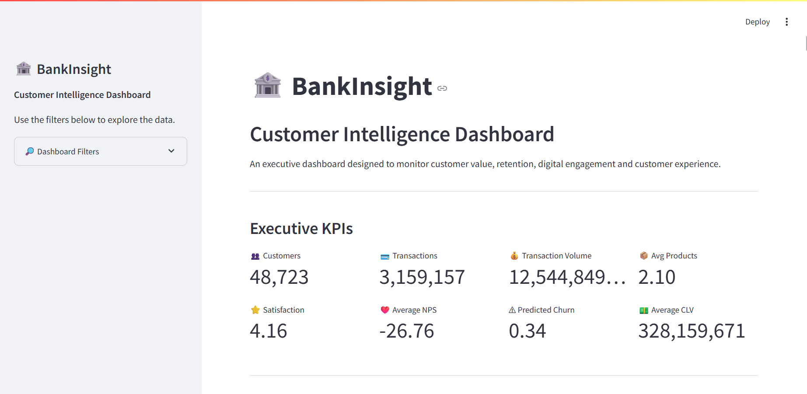

# 🏦 BankInsight: Customer Intelligence Dashboard

## Overview

BankInsight is an interactive business intelligence dashboard developed using **Python**, **Streamlit**, and **Plotly** to support data-driven decision-making within a digital banking environment.

The dashboard transforms customer and transaction data into meaningful business insights, enabling stakeholders to monitor customer value, retention, digital engagement, customer experience, and transaction activity through an intuitive web-based reporting interface.

Rather than focusing solely on data visualization, this project was designed to answer real business questions and communicate actionable recommendations that can support strategic decision-making.

---

## Dashboard Preview



---

# Business Problem

Digital banks generate large volumes of customer and transaction data every day. While this data contains valuable insights, decision-makers often struggle to transform raw information into actionable intelligence.

Business leaders need timely visibility into customer behaviour, retention risk, digital engagement, satisfaction levels, and transaction activity to make informed decisions.

This project addresses that challenge by developing an interactive Customer Intelligence Dashboard that consolidates key business metrics into a single decision-support platform.

---

# Project Objectives

The primary objectives of this project were to:

- Develop an interactive web-based business intelligence dashboard using Python.
- Monitor customer value and predicted churn.
- Evaluate digital engagement and product adoption.
- Analyze customer satisfaction and advocacy.
- Explore customer transaction behaviour.
- Present findings through interactive visualizations and executive-level insights.

---

# Dataset

This project uses a digital banking customer analytics dataset consisting of two related datasets:

### Customer Dataset

Contains customer demographic information, product ownership, engagement metrics, customer satisfaction indicators, and customer value metrics.

### Transaction Dataset

Contains over three million customer transactions, including:

- Customer ID
- Transaction Date
- Transaction Amount
- Transaction Type

The datasets are linked through **customer_id**, allowing customer-level and transaction-level analysis.

---

# Dashboard Features

The dashboard includes the following analytical sections:

## Executive Overview

Provides high-level business KPIs including:

- Total Customers
- Total Transactions
- Transaction Volume
- Average Products per Customer
- Customer Satisfaction
- Net Promoter Score
- Predicted Churn
- Customer Lifetime Value

---

## Customer Value & Retention

Examines the relationship between banking product adoption and customer retention.

Key business question:

> Are customers with more banking products associated with lower predicted churn probability?

---

## Digital Engagement

Explores how digital feature adoption relates to customer experience.

Key business question:

> Is greater feature usage diversity associated with higher product satisfaction?

---

## Customer Experience

Investigates customer satisfaction and customer advocacy.

Key business question:

> Is higher customer satisfaction associated with stronger Net Promoter Scores?

---

## Transaction Intelligence

Summarizes customer transaction activity and transaction type distribution.

Key business question:

> What transaction types dominate customer activity?

---

# Methodology

The project followed an end-to-end data analytics workflow.

## 1. Data Understanding

- Data exploration
- Relationship validation
- Data profiling

## 2. Data Preparation

- Missing value handling
- Data cleaning
- Type conversion
- Data validation

## 3. Exploratory Analysis

Business-driven analysis was performed by testing hypotheses related to:

- Customer retention
- Product adoption
- Customer satisfaction
- Digital engagement
- Customer advocacy

## 4. Dashboard Development

Interactive visualizations were developed using Plotly and presented through Streamlit to create an executive-focused business intelligence dashboard.

---

# Key Business Findings

The analysis produced several important insights.

### Customer Retention

Customers with a greater number of banking products exhibited substantially lower predicted churn probabilities.

### Digital Engagement

Greater feature usage diversity was associated with higher product satisfaction.

### Customer Experience

Customer satisfaction demonstrated a strong positive relationship with Net Promoter Score, suggesting that improved customer experience is associated with stronger customer advocacy.

### Customer Lifetime Value

No meaningful relationship was observed between product ownership and Customer Lifetime Value within this dataset, indicating that customer value should be evaluated independently from product adoption.

---

# Business Recommendations

Based on the findings, the following recommendations were identified:

- Expand cross-selling initiatives to strengthen customer retention.
- Increase awareness and adoption of digital banking features.
- Continue investing in customer experience improvements.
- Evaluate customer value using dedicated value metrics rather than product ownership alone.

---

# Technology Stack

- Python
- Streamlit
- Pandas
- Plotly
- NumPy

---

# Installation

Clone the repository.

```bash
git clone https://github.com/yourusername/BankInsight.git
```

Navigate to the project folder.

```bash
cd BankInsight
```

Install dependencies.

```bash
pip install -r requirements.txt
```

---

# Running the Dashboard

Launch the Streamlit application.

```bash
streamlit run app.py
```

---

# Future Improvements

Potential enhancements include:

- Advanced customer segmentation
- Interactive time-series analysis
- Geographic customer analysis
- Customer-level drill-down reports
- Deployment to Streamlit Community Cloud
- Integration with live data sources

---

# Author

**Jessica Addy**
Data Analyst passionate about transforming data into actionable business insights through analytics, visualization, and storytelling.

**LinkedIn:** *(Add your LinkedIn URL)*

**GitHub:** *(Add your GitHub URL)*

---

## Acknowledgements

This project was developed as part of my data analytics portfolio to demonstrate practical skills in business intelligence, exploratory data analysis, interactive dashboard development, and data-driven decision-making.